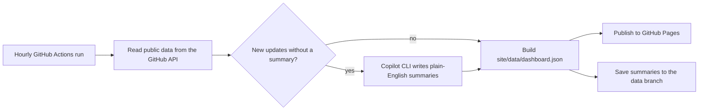

# dashboard

Live dashboard of my GitHub projects, with plain-English summaries of every update.

**Live site: https://gasteren.github.io/dashboard/**

## What's on the page

- **Overview:** how many public projects there are, updates this week and this month, stars, forks, open issues and releases.
- **Latest updates:** every change published to a project's main branch, newest first, explained in a few plain sentences by GitHub Copilot. You can filter by project. Each update has a "Technical details" section with the commits, the number of changed files and links to the change on GitHub. When the same change lands in several projects at once (for example one fix rolled out to 20 add-ons), it is shown as a single card. Direct pushes made entirely by bot accounts (such as a scheduled data refresh) are folded into one "Automatic updates" card per project per week; they aren't sent to Copilot and don't count towards the update totals.
- **Activity and languages:** a chart of changes saved by people per week over the past year (bot accounts are left out) and the mix of programming languages.
- **All projects:** a card per project with its description, language, last update, latest release, number of saved changes (commits by people, with automatic ones shown separately), stars and links to GitHub, CurseForge and the project's website when it has them.

The page works on phones and has light and dark modes.

## How it works



1. Every hour, on every change to `main`, and whenever you press **Run workflow**, [`.github/workflows/dashboard.yml`](.github/workflows/dashboard.yml) runs [`scripts/build.mjs`](scripts/build.mjs).
2. The script lists the repositories of the account in `dashboard.config.json`. Only repositories that are public (`private: false` and `visibility: public`) and owned by that account are kept; everything else is dropped before anything else is read.
3. For each project it reads the update log of the default branch: direct pushes, merged pull requests, merge-queue merges and force pushes. Work on other branches (such as Copilot's `gasteren-*` branches) is ignored. For each update it reads what changed and, for merged pull requests, their title and description.
4. Updates without a summary are batched and sent to [GitHub Copilot CLI](https://docs.github.com/en/copilot/how-tos/copilot-cli/use-copilot-cli-in-actions), which answers with a short headline, one to three sentences, and whether people using the project will notice the change. Until a summary exists, the card shows the developer's own note instead.
5. The website in [`site/`](site/) and the generated `site/data/dashboard.json` are published to GitHub Pages.
6. Summaries and a small cache are saved as a single snapshot commit on the [`data`](../../tree/data) branch, so every update is summarized only once. Nothing is ever committed to `main`, so the dashboard doesn't fill its own feed.

## Cost

Copilot CLI runs inside GitHub Actions with the workflow's built-in token (`copilot-requests: write`), so no personal access token is needed. Usage is billed as AI credits to the repository owner's Copilot seat (1 AI credit = $0.01).

- The default model is `gpt-6-luna` ($0.10 per million input tokens, $0.50 per million output tokens). If it isn't available, the run falls back to `gpt-5.6-luna`.
- Copilot is only called when there are new updates. Each update is summarized once, identical changes share one summary, and up to 15 updates go into one call. A call of that size is a few tens of thousands of tokens, which is well under one AI credit.
- Hard limits, all set in `dashboard.config.json`:
  - `maxAiCreditsPerCall` (30): passed to Copilot CLI as `--max-ai-credits`. 30 is the lowest value the CLI accepts.
  - `maxAiCreditsPerRun` (20) and `maxAiCreditsPerDay` (100): the run stops calling Copilot once it reaches either budget. If the CLI's usage report can't be read, a call counts as the full 30 credits, so the limits never depend on that report.
  - `maxCallsPerRun` (4).
- To see what was used: open a run under **Actions → Dashboard**, and look at **Copilot usage** on its summary page. A running history is kept in `ai-usage.json` on the `data` branch.

## Settings

Edit [`dashboard.config.json`](dashboard.config.json) on GitHub and commit; the site rebuilds right away.

| Setting | What it does | Default |
| --- | --- | --- |
| `owner` | GitHub account to show | `Gasteren` |
| `title`, `tagline` | Heading and intro text on the page | |
| `exclude` | Repository names to leave out, for example `["Gasteren", "old-test"]` | `[]` |
| `includeForks` | Show repositories forked from someone else | `false` |
| `includeArchived` | Show archived repositories (marked "Archived") | `true` |
| `curseforgeLinks` | Set or fix a project's CurseForge link, for example `{"HandyNotes_AncientShrines": "https://www.curseforge.com/wow/addons/handynotes-ancientshrines"}`. Use `null` to hide a link. | `{}` |
| `feed.days` | How far back the feed goes | `180` |
| `feed.groupWindowHours` | Identical changes this close together become one card | `12` |
| `ai.enabled` | Turn Copilot summaries on or off | `true` |
| `ai.models` | Models to try, in order | `["gpt-6-luna", "gpt-5.6-luna"]` |
| `ai.reasoningEffort` | Reasoning effort passed to the CLI (`low` keeps it cheap); use `null` to leave it out | `low` |
| `ai.maxAiCreditsPerCall` | Copilot CLI `--max-ai-credits` for each call (minimum 30) | `30` |
| `ai.maxAiCreditsPerRun` | Budget for one run | `20` |
| `ai.maxAiCreditsPerDay` | Budget for any 24 hours | `100` |
| `ai.maxCallsPerRun` | Most Copilot calls in one run | `4` |
| `ai.maxUpdatesPerCall` | Most updates summarized in one call | `15` |

CurseForge links are found automatically when a project's homepage points to CurseForge, or its README links a CurseForge page whose name matches the project (links to other add-ons, such as HandyNotes, are ignored).

### Change the schedule

Edit the `cron` line in [`.github/workflows/dashboard.yml`](.github/workflows/dashboard.yml). It uses UTC. For example `'23 */3 * * *'` runs every three hours and `'23 6 * * *'` once a day. GitHub can start scheduled runs a few minutes late.

### Skip the AI for one run

**Actions → Dashboard → Run workflow** and tick **Build without calling Copilot**.

### Rewrite all summaries

Delete the `data` branch. The next runs rebuild everything, within the cost limits above (a backlog is worked through over several hourly runs).

## Keeping the hourly schedule alive

GitHub pauses scheduled workflows in public repositories after 60 days without repository activity. To prevent that, the workflow re-enables itself once a day through the official API (the `keepalive` job, which only has `actions: write`), and the `data` branch gets a fresh snapshot whenever something changes. The site also shows a notice when its data is more than three hours old. If updates ever stop, open **Actions → Dashboard** and select **Enable workflow**, or run `gh workflow enable dashboard.yml -R Gasteren/dashboard`.

## Privacy and safety

- Only public repositories are read and published. The build checks visibility explicitly, even though the workflow's token can't see private repositories anyway, and it refuses to publish if anything outside the selected public projects ends up in the output.
- Copilot CLI runs in an empty temporary folder with shell, file-writing and web tools denied, without MCP servers or custom instructions. It only receives public commit messages, pull request text, file names and short excerpts of changes.
- Each job has only the permissions it needs: building (read the code and make Copilot requests), saving the `data` branch (write contents), publishing (Pages) and the keepalive (re-enable the workflow). The workflow never runs for pull requests, so forks can't trigger it.

## Run it on your own computer

Requires Node.js 22 or newer and the [GitHub CLI](https://cli.github.com/).

```sh
GH_TOKEN=$(gh auth token) npm run build:no-ai   # collect data without calling Copilot
npm run serve                                   # preview at http://localhost:8080/
npm test                                        # unit tests
```

Local runs keep their data in `state/` and write `site/data/dashboard.json`; both are git-ignored and nothing is published. Even with a token that can see private repositories, only public ones are used.

## Files

| Path | Purpose |
| --- | --- |
| `dashboard.config.json` | Settings |
| `scripts/build.mjs` | Collects data, asks Copilot for summaries and writes the site data |
| `scripts/lib/` | GitHub API client, Copilot CLI wrapper, feed and text helpers |
| `scripts/test/` | Unit tests (`npm test`) |
| `site/` | The website: plain HTML, CSS and JavaScript, no build step |
| `.github/workflows/dashboard.yml` | Hourly build, Copilot summaries, data branch and Pages deploy |
| `.github/workflows/test.yml` | Runs the unit tests on every push |
